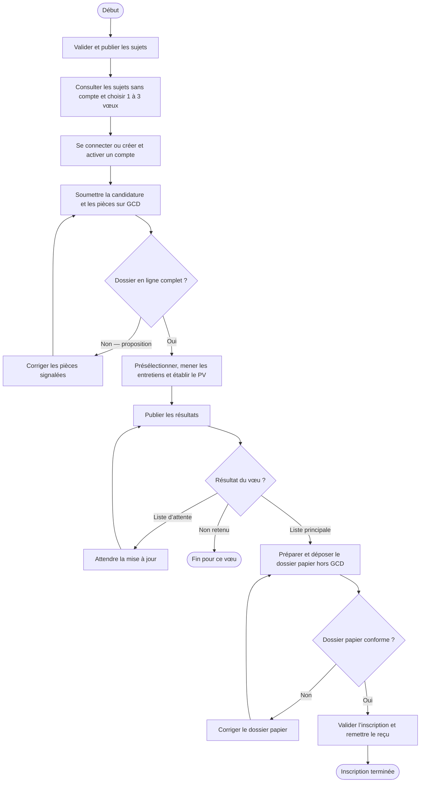
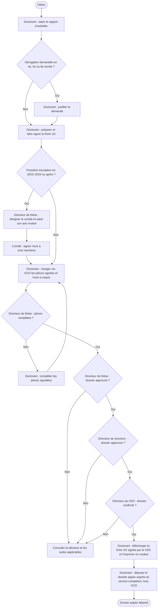
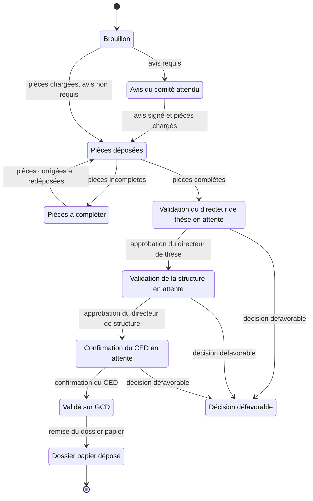
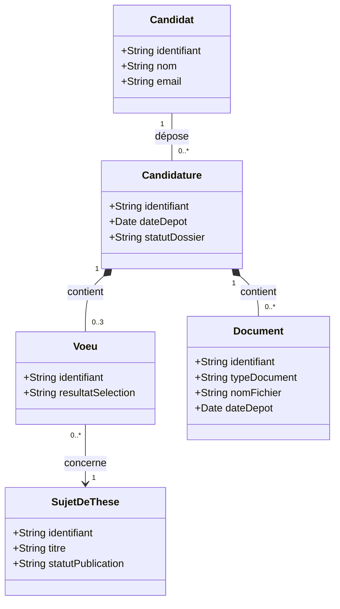

# Diagrammes UML GCD

**Légende** — Sur GCD : en ligne. Hors GCD : démarche externe. Proposition : amélioration envisagée. À confirmer : règle à vérifier.

## 1. Activité — inscription initiale (parcours proposé)

La consultation sans compte, le panier de trois vœux et le redépôt après correction font partie du parcours proposé.

## 2. Activité — réinscription annuelle

Les conditions d’année et le formulaire final viennent du guide GCD 2026–2027. La boucle de correction des pièces est une proposition. Les suites d’un refus et les modalités de recours restent à confirmer.

## 3. États — dossier de réinscription

Le suivi distingue la validation sur GCD du dépôt administratif papier. Le retour « pièces à compléter » est proposé. Les motifs et les suites des décisions défavorables restent à confirmer.

## 4. Classes — candidature avec panier de vœux

Une candidature peut rester sans vœu au brouillon. À la soumission, elle doit contenir de un à trois vœux portant sur des sujets distincts. Les pièces sont rattachées à la candidature et servent à tous ses vœux. Le résultat est suivi par vœu.

## Sources de travail

- [Diagrammes et synthèses du dépôt devweb](https://github.com/youssefelhathat-cmd/devweb)
- [Diagrammes de référence d’omardarif](https://github.com/omardarif/UML-diagrame)
- [Diagramme d’états de Zineb Elkrichi](https://github.com/ZinebElkrichi/TP-DEV-LOGICIELS/blob/main/diagramme_etats_transmission_candidature.png), référence pour le retour du dossier à compléter.
- Guide GCD de réinscription 2026–2027, sections sur la dérogation, l’avis du comité de thèse et le dépôt du dossier administratif.

